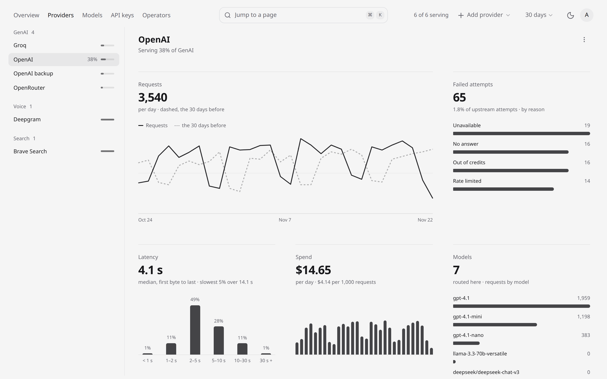
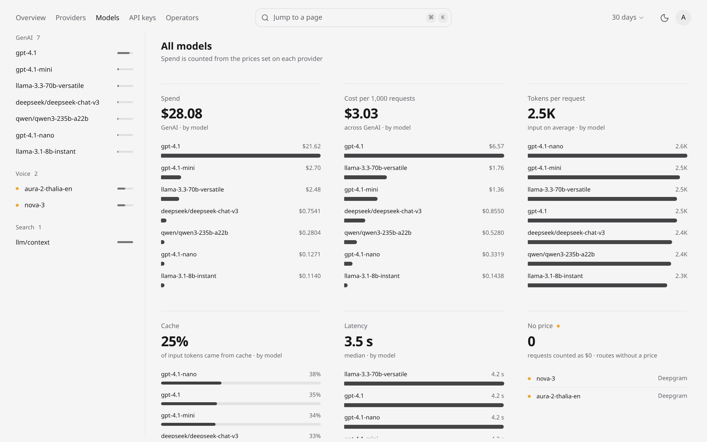
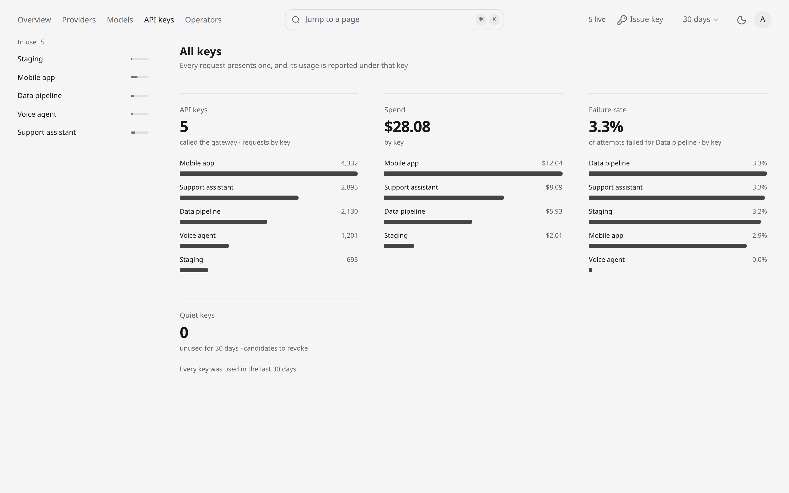

# Sentinel

Sentinel is a self-hosted gateway in front of your AI provider accounts. It pools the accounts of
each kind (OpenAI-compatible chat, Deepgram-compatible voice, Brave-compatible search), fails over
between them when one errors, rate limits or runs out of credits, and answers any client that holds
one of the API keys it issued. A web console sets up the providers, issues the keys and shows the
traffic live.

<picture>
    <source media="(prefers-color-scheme: dark)" srcset="docs/screenshots/overview-dark.png">
    
</picture>

- **One endpoint, many accounts.** Clients keep their SDK and point its base URL at Sentinel.
- **Failover.** A request that fails on one provider moves on to the next one serving that model. A
  provider that fails three times in a row rests for 30 seconds, and one out of credits for ten
  minutes.
- **Keys you can revoke.** Each app gets its own `snt_…` key, and its usage is reported under that
  key.
- **Spend and health in one place.** Cost is worked out from the prices you set on each model.

## Self-hosting

You need Docker with Compose. The stack runs Postgres 18, Redis, the api and the console.

```sh
git clone https://github.com/pollium/Sentinel.git
cd Sentinel
cp .env.example .env
```

Fill the three empty values in `.env`:

```sh
POSTGRES_PASSWORD=   # openssl rand -hex 16
ENCRYPTION_KEY=      # openssl rand -hex 32
JWT_SECRET=          # openssl rand -hex 32
```

Start it:

```sh
docker compose up -d --build
```

Open the console at `http://localhost:8081` and create the owner account. **Do it right after the
first boot:** until an operator exists, anyone who can reach the api can claim that account.

Then, from the console:

1. **Providers → Add provider.** Give it a name, the base URL and the account's API key, then list
   the models it serves with their prices (**Detect** fetches the list from the provider). Add
   several accounts of the same kind to pool them.
2. **API keys → Issue key.** The secret is shown once. Copy it.

### Configuration

Everything is read from the root `.env`.

| Variable | Default | What it is |
|---|---|---|
| `SENTINEL_PORT` | `8081` | Port of the console |
| `SENTINEL_API_PORT` | `8080` | Port of the api, which is what clients call |
| `WEB_URL` | `http://localhost:8081` | Where invitation links point. Set it to the console's public URL |
| `POSTGRES_PASSWORD` | required | Password of the bundled Postgres |
| `ENCRYPTION_KEY` | required | 32 bytes as 64 hex characters (or base64). Encrypts every provider key |
| `JWT_SECRET` | required | Signs the operators' sessions |
| `UPSTREAM_FIRST_BYTE_TIMEOUT_MS` | `120000` | How long to wait for a provider's first byte before moving on |

### Pointing a client at it

Clients call the api port, not the console. Each kind speaks its vendor's protocol, so the vendor's
SDK works as is:

| Kind | Base URL | The key goes in |
|---|---|---|
| Chat (OpenAI) | `http://your-host:8080/v1` | `Authorization: Bearer snt_…` |
| Voice (Deepgram) | `http://your-host:8080` (`/v1/speak`, `/v1/listen`, `/v1/models`) | `Authorization: Token snt_…` |
| Search (Brave) | `http://your-host:8080/res/v1/llm/context` | `X-Subscription-Token: snt_…` |

```sh
curl http://localhost:8080/v1/chat/completions \
    -H "Authorization: Bearer $SENTINEL_KEY" \
    -H 'Content-Type: application/json' \
    -d '{"model": "gpt-4.1-mini", "messages": [{"role": "user", "content": "Hello"}]}'
```

The model has to be listed on at least one active chat provider.

### Operators

Operators are the accounts of the console, and every operator can do everything. Invite one from
**Operators → Invite**, or from the shell, which prints the link:

```sh
docker compose exec api pnpm invite someone@example.com
```

Links expire after 7 days.

### Running it for real

- Put a reverse proxy with TLS in front of both ports. The stack itself serves plain HTTP.
- Back up `ENCRYPTION_KEY` together with the database. With any other key no provider decrypts, and
  the pools serve nothing.
- Data lives in the `postgres-data` and `redis-data` volumes.
- To update, `git pull && docker compose up -d --build`. The schema updates itself on boot.

## Screenshots

A provider: its requests against the 30 days before, the attempts it failed and why, latency, spend,
and the models routed to it.

<picture>
    <source media="(prefers-color-scheme: dark)" srcset="docs/screenshots/provider-dark.png">
    
</picture>

Models: spend, cost per 1,000 requests, tokens per request, cache hits, latency, and the routes that
have no price yet.

<picture>
    <source media="(prefers-color-scheme: dark)" srcset="docs/screenshots/models-dark.png">
    
</picture>

API keys: requests, spend and failure rate by key, and the keys nobody has used in 30 days.

<picture>
    <source media="(prefers-color-scheme: dark)" srcset="docs/screenshots/keys-dark.png">
    
</picture>

## Development

```sh
pnpm install
cp packages/apps/api/.env.example packages/apps/api/.env   # fill ENCRYPTION_KEY and JWT_SECRET
pnpm dev                                                   # api on :8080, console on https://localhost:5175
```

[AGENTS.md](AGENTS.md) explains how the code is laid out.
